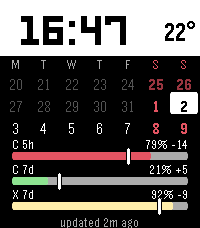

# Pebble Quota

A Pebble Time 2 watch face showing Claude Code and Codex quota consumption against a sustainable, constant-use pace.

## Collector

`gogo` already has authenticated Claude Code and Codex CLIs. The collector keeps those credentials on `gogo`, writes a local snapshot, and serves only compact quota data.

```bash
python3 collector/pebble_quota.py collect
PEBBLE_QUOTA_TOKEN='replace-me' python3 collector/pebble_quota.py serve
```

Authenticated endpoint:

```text
GET /v1/watch
Authorization: Bearer <token>
```

Settings page for the Pebble phone app (no auth — a fresh install has no
token yet):

```text
GET /config
```

Response fields are intentionally compact for PebbleKit JS:

- `s`: `C` for Claude Code, `X` for Codex
- `w`: quota window label
- `u`: integer percentage used
- `r`: reset time as Unix seconds
- `d`: window duration in seconds
- `p`: pace surplus in percentage points; positive is ahead, negative is behind
- `t`: outside temperature in integer tenths of °C (optional; omitted when Home Assistant is unavailable or the reading fails unit/age validation)

Claude collection uses an undocumented OAuth endpoint used by Claude Code itself. Codex collection uses the supported local app-server JSON-RPC method `account/rateLimits/read`.

Codex RPC failures use fixed diagnostics naming the failing stage
(`initialize` or `rate limits`) and cause: RPC error, response timeout,
unexpected EOF, invalid JSON, invalid response/result, or pipe failure. An RPC
error calls for checking CLI login and protocol compatibility through an
authorized operator; raw RPC error messages, data and stdout are never published.
Notifications do not extend the 15-second response deadline. Legitimate empty
window sets report `Codex rate limits: no quota windows`; malformed results fail collection, and valid sibling windows
survive malformed windows. The child is terminated, killed if it exceeds the
two-second exit grace, reaped, and its pipes closed on success and failure.

Codex CLI compatibility is **unverified as of 2026-10-22**: this change was
validated with fake app-servers only, without invoking an authenticated CLI.
The fixtures model initialize's `userAgent` result and both wrapped
`rateLimits` and legacy direct window results. No installed CLI version was
used for compatibility verification. The steward handles the service restart
after acceptance.

Claude HTTP 429 responses pause subsequent Claude requests until a persisted
`retry_at` deadline. Positive `Retry-After` seconds and HTTP dates take precedence;
missing, zero, invalid or expired values use 10, 20, 40, then 60 minutes between
attempts. Requests resume on the first refresh at or after that deadline. Codex
and temperature continue refreshing during the cooldown. Success clears the retry
state. The state survives restarts and repeated `collect` commands when they use
the same output file.

In the full snapshot, a failed Claude refresh keeps its last successful `windows`
alongside the existing service `error`, with `stale: true`, `last_success_at` and
`age_seconds`. Age counts from the successful reading, not from the last retry.
`collected_at` still describes the current collection pass. With no previous
Claude reading, the service has an error and retry state but no windows. A first
429 saves this state even if Codex also fails. The watch payload keeps its existing
format and includes the retained windows; the steward can still read both windows
and per-service errors. Consumers must use the service's `error` or `stale` field
to distinguish retained windows from a fresh reading.

Quota windows are validated individually on collection and every snapshot read.
Usage must be a finite JSON number in `[0, 1]` (provider percentages in `[0, 100]`);
strings, booleans and out-of-range values are rejected, never clamped. Reset times
must be nonnegative integral Unix seconds or timezone-aware ISO 8601 timestamps,
through `2147483647` seconds (the watch uses signed 32-bit values). ISO fractional
seconds are truncated when encoded for the watch. Numeric strings and timestamps
without timezones are rejected. Durations must be integer seconds from 1 through
21,474,836, avoiding overflow in the watch's duration-times-100 calculation.
Window labels must fit seven printable ASCII characters. The supported Claude
model scope is Fable, encoded as service `F`, window `7d`; malformed or unsupported
scopes are skipped. At most five validated rows are sent to the watch.

Snapshots are untrusted: missing, corrupt or malformed containers and invalid
scheduling fields are discarded without guessing replacement values. Healthy
providers still run. Bad windows cannot suppress valid siblings. A refresh without usable rows
retains prior validated quota and its collection time while persisting
attempt/cooldown metadata; retained services carry `stale: true`. Atomic file
replacement preserves the prior disk file on write failure, while the running
collector retains scheduling state in memory. Persistent disk failure prevents
restart guarantees until writes recover.

A first 429 with no usable rows saves cooldown state but raises an unavailable
reading error, as does total failure without previous quota. This scheduling-only
state is not a successful publication. The authenticated HTTP endpoint returns
503 `Snapshot unavailable` for missing, damaged or rowless snapshots (including
cooldown-only state); valid rows in partially damaged snapshots remain available.
Diagnostics in snapshots and logs contain fixed categories such as `HTTPError`
rather than provider exception messages, URLs, response bodies or credentials.

Outside temperature is a best-effort read of the Home Assistant entity `weather.forecast_koti` (met.no forecast for Koivusyrjä). It uses `HASS_TOKEN` (a Home Assistant long-lived token, kept outside the repo on `gogo`) and `HASS_SERVER` (default `http://localhost:8123`). A Home Assistant outage never blocks quota delivery: the temperature is simply omitted rather than reported as a fabricated value.

The collector accepts only `attributes.temperature_unit` values `°C` and `°F`.
Fahrenheit uses `(F - 32) * 5 / 9`; both units are rounded to integer tenths of
Celsius with Python's `round`. Missing/unknown units, missing/nonnumeric/nonfinite
values, and unknown/unavailable entities produce no temperature.

Entity freshness requires an ISO 8601 `last_updated` with an explicit timezone,
aged from zero through 7,200 seconds at collection time. Missing, malformed,
timezone-free, future or older timestamps produce no temperature. The two-hour
limit allows an hourly weather update plus collection delay. It is a conservative
entity-age limit, not proof of when met.no observed the weather. HA's
[`last_updated`](https://contributors.home-assistant.io/core/internals/states/)
tracks state or attribute changes; unchanged weather can therefore age out, and
an unrelated attribute change can refresh the entity timestamp. There is no
fallback to `last_changed`, `last_reported` or the collection time.

Each collection omits rejected temperature rather than retaining an older value.
HTTP/network/JSON failures are recorded in `temperature_error` without removing
quota data. Tests mock HA responses, time and credentials; they require no live HA.
This check applies at collection time. An existing snapshot or an offline phone
can still display an older accepted temperature. Task [9](docs/tasks/9-carry-freshness-and-failure-status-through-to-watch-rendering.md)
will carry the original temperature timestamp through the API and phone to
enforce display expiration
when that proposal is promoted; its cross-device freshness work remains pending.

## Watch face

The v1 face targets Pebble Time 2 (`emery`). Download the installable `.pbw`
from the [latest GitHub release](https://github.com/akaihola/pebble-quota/releases/latest).

To build it locally:

```bash
cd watchface
make clean build
```

The generated installable bundle is `watchface/build/watchface.pbw`.



The tested emulator path on headless NixOS is documented in [`watchface/README.md`](watchface/README.md).

### Releasing

Release Please maintains a release PR with the next `major.minor.0` version in
`watchface/package.json`. Merge that PR to release. CI builds the watchface,
creates the matching `vX.Y.0` tag and GitHub release, and uploads the `.pbw`.

Set the `RELEASE_PLEASE_TOKEN` repository secret to a fine-grained personal
access token with Contents, Issues, and Pull requests read/write access so CI
also runs on the generated release PR.

## Tests

```bash
python3 -m unittest discover -s tests -v
```

## Status

The collector runs continuously on `gogo` as `pebble-quota.service`, refreshing quota data every five minutes. Its loopback API is exposed privately to the tailnet at:

```text
https://gogo.crane-boa.ts.net:8450/v1/watch
```

The authenticated endpoint, PebbleKit JS transport, Emery watch face, and headless-emulator path are working. The settings page stores the endpoint and service token in PebbleKit JS local storage without committing the token. See the [physical Pebble installation instructions](watchface/README.md#install-on-a-physical-pebble) and [task tracker](TASKS.md) for remaining work.
