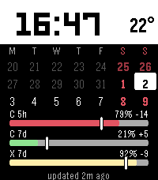

# Quota Pace watch face

Pebble Time 2 (`emery`) watch face for Claude Code and Codex subscription quotas.

The layout stacks three regions top to bottom:

1. **Time** — a large black-on-white band at the top (Clean Calendar style). When
   the phone provides it, the local outside temperature (e.g. `22°`, read from the
   Home Assistant `weather.forecast_koti` entity) sits at the right of this band.
2. **Calendar** — a compact colored three-week calendar, Monday-first, ForecasWatch 2 style. Today sits in the middle week inside a white box; weekends are red, adjacent-month days are dimmed.
3. **Pace bars** — one compact gauge per quota window squeezed into the bottom:
   `Claude 5h`, the combined `Claude+Fable 7d`, `Codex 5h`, `Codex 7d`.

Each pace gauge shows:

- service and quota window title, with the sync status (`updated Nm ago`,
  `phone sync pending`) right-aligned on the first gauge's title row
- consumed quota as a vivid pace-colored bar over a bright light-gray remaining track
- ideal constant-use pace as a white, black-outlined marker

The Claude 7d and Fable 7d windows share one `Claude+Fable 7d` gauge: two color
bars 1px apart, one per window, with a single window marker spanning both (both
windows reset together). Pace color still carries the surplus state per bar:
green ahead of schedule, yellow slightly behind, red draining too quickly.



## Calendar date math

The three-week grid is anchored on today: today's Monday-first weekday index
(`(tm_wday + 6) % 7`) places it in the middle week, and every cell is
`today ± N` days computed via `mktime` on a local-noon anchor (avoiding DST
edges). Month/year rollovers and leap days fall out of `mktime`/`localtime`
naturally; verified against a host-compiled harness for the current date, year
and month boundaries, a leap day (2028-02-29), and a EU DST-change Sunday.

## Build on gogo/NixOS

```bash
make clean build
```

The Makefile selects the ARM compiler bundled with Pebble SDK 4.17. Calling `pebble build` directly on this NixOS host may select the host `sccache-cc` wrapper instead.

Output:

```text
build/watchface.pbw
```

## Emulator screenshot

The QEMU emulator needs a temporary X display and a Nix library closure on headless `gogo`:

```bash
nix-shell --run 'xvfb-run -a sh -c "pebble install --emulator emery && sleep 3 && pebble screenshot --emulator emery quota-pace.png && pebble kill"'
```

## Install on a physical Pebble

Copy `build/watchface.pbw` to the phone (USB, Syncthing, or any download) and
open it with the Pebble app — it sideloads over the installed face in place.
Alternative: enable the developer connection in the phone app, then run
`pebble install --phone <phone-ip>` from this directory.

The JS side already points at the production collector endpoint; only the token
ships as `test-only-token` (overridable via `localStorage`). There is no
settings UI for it yet, so whatever token setup the current install uses
carries over unchanged.

## Phone-side endpoint

During emulator development, `src/pkjs/index.js` defaults to:

```text
http://127.0.0.1:8765/v1/watch
test-only-token
```

These defaults must be replaced or configured before installing on Android. The collector accepts the token in the `Authorization: Bearer` header; Claude/OpenAI credentials remain on `gogo`.
